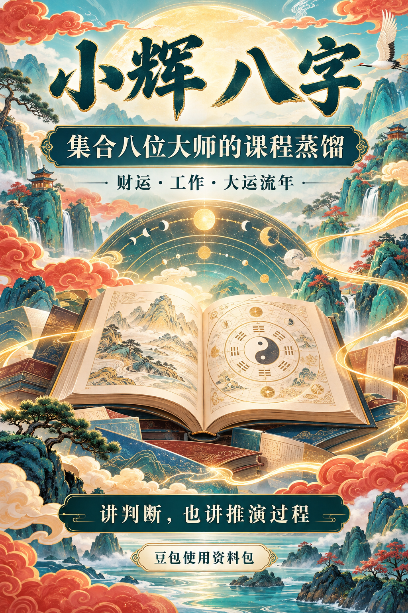

# 小辉 八字

豆包使用指令与八字知识资料包。蒸馏了8位老师的课程，涵盖基础规则、格局取用、实战案例、财运、工作与大运流年分析。给出判断，也展开推演过程。

## 豆包使用

1. 将 [使用指令](01_小辉八字_豆包使用指令.txt) 粘贴到豆包对话，或你所用入口的角色指令栏。
2. 将 [知识资料](02_小辉八字_知识资料.txt) 作为附件提供给豆包。
3. 提供具体问题及出生资料，或已排好的四柱与大运表。

如果所用入口对附件大小有限制，下载并解压下方完整资料包，按问题上传 `xiaohui-bazi/references/library/` 中对应资料。这里只提供指令与资料，不要求豆包直接安装 Codex skill，也不承诺所有入口都能完整读取大附件。

## 文件

- `01_小辉八字_豆包使用指令.txt`：角色指令、资料调用和推演方法。
- `02_小辉八字_知识资料.txt`：合并知识文本。
- [完整资料包下载](小辉八字_豆包版.zip)：包含分文件的 `xiaohui-bazi/` skill 与参考库；展示名称为“小辉 八字”。
- `小辉八字_彩色广告页.png`：用户指定文案的广告画。
- `使用说明.txt`：资料范围及使用说明。

## 资料状态

8位老师的课程蒸馏初稿覆盖齐全，终审校勘未完成。资料快照为2026-09-29，打包日期为2026-10-02。用于传统命理学习与辅助分析，保留条件、分歧、来源及待核项。

不含原视频、完整自动转录、个人出生资料和个人预测反馈，也不含可执行排盘程序。
